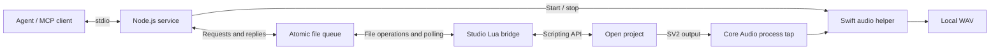

# Synthesizer V Studio Agent

English | [简体中文](README.zhcn.md)

## Project overview

[Synthesizer V Studio 2 Pro (SV2)](https://dreamtonics.com/synthesizerv/) is Dreamtonics' AI singing synthesis editor, where users create vocal performances from notes and lyrics and refine their pitch and expression. Its [scripting API](https://resource.dreamtonics.com/scripting/) exposes project objects, selections and playback to JavaScript and Lua scripts.

This project connects that scripting environment to local AI agents through the Model Context Protocol (MCP). A Node.js service and a Lua script inside Studio exchange structured requests through an atomic file queue. Agents can inspect the open project, edit notes and parameter curves, manage tracks and groups, adjust tempo, voice attributes and mixer settings, and control playback while users continue working in Studio. The MCP client supplies the model and agent workflow.

The current implementation provides **31 tools** and has been tested on **macOS with Studio 2.2.1 and its embedded Lua 5.4**. macOS audio capture records SV2 playback to WAV. Project saving, offline audio export and singer database selection are not exposed by the documented scripting API. Other operating systems have not been validated.

## Installation examples

### Install the Studio bridge

You need Synthesizer V Studio 2 Pro with scripting support and Node.js 20.11 or later; Node.js 22 or later is recommended. Run these commands from the project directory:

```sh
npm ci
npm run install-bridge
```

On macOS, the installer prepares `.sv-agent/`, installs a small loader in Studio's scripts folder and prints MCP configuration with the actual local paths. In Studio, open a project, choose **Scripts → Rescan**, then run **SV Agent Bridge**.

The bridge stays active for that project. Running the script again resumes the same logical session. Use `sv_stop_bridge` to stop it; opening a different project stops the current bridge and requires another start.

To specify a scripts folder or a different queue directory:

```sh
node scripts/install-bridge.mjs --scripts-dir /absolute/path/to/studio/scripts --dir /absolute/path/to/bus
```

Platforms other than macOS require `--scripts-dir`. Both sides must use the same queue directory, and the filesystem must support atomic replacement by Lua's `os.rename`.

### Connect an MCP client

Add the configuration printed by the installer to your MCP client. Alternatively, use [mcp-config.example.json](mcp-config.example.json), replacing `/absolute/path/to/sv_studio4agent` with the checkout path. If the client cannot resolve `node`, set `command` to the executable's absolute path. Reload the client's MCP configuration after adding the server.

The entry point is `src/cli.mjs`, using stdio. The default queue is `.sv-agent/` in this checkout. For the custom directory above, configure the server to run:

```sh
node src/cli.mjs --dir /absolute/path/to/bus
```

`SV_AGENT_DIR` also sets the queue directory for the installer and server. The service requires no API key of its own.

You can check the same MCP interface with the included client:

```sh
node scripts/agent-client.mjs list
node scripts/agent-client.mjs sv_status
node scripts/agent-client.mjs sv_get_project_summary
```

`sv_status` should report `online: true` and the expected project path before you edit. `BRIDGE_OFFLINE` means the Studio script is stopped or its heartbeat is stale.

### Enable audio capture on macOS

Audio capture requires **macOS 14.2+** and Xcode Command Line Tools (or Xcode). Build the Swift helper locally:

```sh
npm run build-audio
node scripts/agent-client.mjs sv_audio_status
```

The first recording may ask for system audio recording permission. Grant it to the application named by macOS, which can be the MCP launcher. The process tap includes only **Synthesizer V Studio 2 Pro**; it does not record the microphone. Sandboxed launchers can hide SV2's audio process or block capture. If the probe reports zero processes while SV2 is running, run the MCP service in a local environment with Core Audio access.

Stop playback, confirm `sessionId`, and call `sv_capture_audio` with a unique ID:

```json
{
  "sessionId": "session-id-from-status",
  "requestId": "unique-take-id",
  "startSeconds": 15,
  "durationSeconds": 8,
  "tailSeconds": 0.3
}
```

The tool waits for capture readiness, seeks and plays, stops playback, closes the WAV and restores the previous stopped playhead. It returns an absolute output path and signal statistics. Files and durable results are stored in `.sv-agent/recordings/`. Use the same ID and identical arguments for retries; `sv_get_audio_result` inspects a take after interruption. Configure your MCP client's tool timeout above the requested duration plus 40 seconds; the included CLI allows 180 seconds.

Capture takes real time and includes all audible SV2 tracks, accompaniment and effects. Use `sv_set_track_mixer` to solo a vocal track first. Lead-in, IPC scheduling and tail mean the WAV is **not sample-aligned offline export**. Silence, dropped buffers, invalid PCM and premature capture termination return errors. See [macOS audio implementation](docs/MACOS_AUDIO.md) for permission, timing and recovery details.

## Development guide and architecture

### How it works



Node publishes each request as an immutable JSON file, then atomically updates the queue index. A file lock coordinates concurrent publishers. Lua polls the index through `SV:setTimeout`, validates requests and calls the host API. It records the completed result before publishing the reply. Writes use a temporary file in the destination directory followed by `rename`; the Lua bridge uses file I/O without launching a shell or network helper.

A session binds requests to the open project. The bridge polls every 50 ms and publishes a heartbeat every second; the server rejects new work once that heartbeat is over 6 seconds old. Repeated script starts preserve `sessionId` and replace `runtimeId`, allowing a new callback loop to take over. One queue directory serves one active bridge.

### Interfaces and editing workflow

| Area | MCP tools |
| --- | --- |
| Status and recovery | `sv_status`, `sv_capabilities`, `sv_get_request_result`, `sv_stop_bridge` |
| Project and selection reads | `sv_get_project_summary`, `sv_read_project`, `sv_get_notes`, `sv_get_selected_notes` |
| Note edits | `sv_update_notes`, `sv_add_notes`, `sv_delete_notes` |
| Parameter curves | `sv_get_parameter_points`, `sv_set_parameter_points` |
| Project structure | `sv_get_project_structure` |
| Tracks and mixer | `sv_create_track`, `sv_remove_track`, `sv_rename_track`, `sv_set_track_mixer` |
| Library groups and references | `sv_create_note_group`, `sv_rename_note_group`, `sv_remove_note_group`, `sv_attach_note_group`, `sv_detach_note_group`, `sv_set_group_reference` |
| Tempo, meter and voice attributes | `sv_set_time_axis`, `sv_set_voice_attributes` |
| Playback | `sv_get_playback`, `sv_playback` |
| macOS audio | `sv_audio_status`, `sv_capture_audio`, `sv_get_audio_result` |

Before editing, read `sv_status` to confirm the project and obtain `sessionId`. Find the target `groupUuid` in the project summary, then call `sv_get_notes` to obtain its current `revision`. For example, pass this payload to `sv_update_notes`, replacing the placeholder values:

```json
{
  "sessionId": "session-id-from-status",
  "groupUuid": "target-group-uuid",
  "expectedRevision": "revision-from-notes",
  "requestId": "unique-edit-id",
  "updates": [{ "index": 1, "set": { "pitch": 67, "lyrics": "la" } }]
}
```

All edit, playback and stop tools require `sessionId`. Group edits also require `expectedRevision`; reread after a conflict or use the new revision returned after an edit. Structured edits validate the entire batch before starting an undo record, so they can be undone in Studio.

Structural, mixer, voice and time-axis mutations require `expectedProjectRevision` from `sv_get_project_structure`. This revision includes exposed structure, voice attributes, mixer values, tempo/meter and group note/curve revisions. Track UUIDs and group reference indices also guard the target. Remove all references before deleting a library group; main groups cannot be detached, and the final track cannot be removed. Removing a track removes its references while retaining shared library groups.

`sv_set_voice_attributes` changes group reference defaults and named `vocalModeParams`; it does not choose a singer database. Use vocal mode names supported by the assigned singer. `getVoice()` can omit default attributes or return an empty mode map; it does not enumerate the singer's available modes. The host stores some values as Float32, so allow a small tolerance on readback. Meter edits use **zero-based measure numbers**, while tempo marks use blick positions.

Note and track indices are **1-based**. Note times and parameter positions use **blicks**, with 705,600,000 blicks per quarter note; playback seek uses **seconds**. Note times are relative to the group, and editing a shared group affects all its references. Supported curves are `pitchDelta`, `vibratoEnv`, `loudness`, `tension`, `breathiness`, `voicing`, `gender` and `toneShift`; use the ranges returned by the host.

Retry the same operation with the same `requestId` and payload to retrieve its stored result. After a timeout, inspect that ID with `sv_get_request_result` before issuing another edit. An interrupted execution without a durable result returns `INDETERMINATE` and is not automatically repeated. Cancellation cannot roll back an edit that has already started. See the [protocol specification (Chinese)](docs/PROTOCOL.md) for envelopes, limits and recovery behavior.

### Source layout and tests

| Path | Responsibility |
| --- | --- |
| `src/queue.mjs` | Atomic publication, publisher lock, sessions and replies |
| `src/server.mjs`, `src/tools.mjs`, `src/cli.mjs` | MCP schemas, tool dispatch and stdio entry point |
| `lua/SVAgentBridge.lua` | Polling, lifecycle and execution records |
| `lua/engine.lua`, `lua/extended.lua`, `lua/json.lua` | Host operations, structural validation and JSON codec |
| `src/audio.mjs`, `native/macos/` | Capture lifecycle and the SV2 process tap |
| `scripts/` | Installer, MCP client and live integration test |
| `tests/` | Queue, MCP and Lua tests with a simulated host |

To add an operation, update the tool definition and MCP schema, implement host-side validation and dispatch, and test its failure and recovery behavior. The installed loader reads the workspace Lua modules on each start: stop and restart the bridge after editing them. Rescan Studio after changing the loader itself, and reinstall after moving the checkout.

```sh
npm test
# Use a specific Lua 5.4 executable if needed:
LUA_BIN=/absolute/path/to/lua npm test
```

Automatic tests need an external Lua 5.4 interpreter; normal operation uses Studio's embedded Lua. They do not require Studio or local project assets. The implementation has passed automated queue, Lua, MCP and capture lifecycle tests. Live tests cover note edits, structural edits, time-axis and voice/mixer changes, a solo vocal take and a transposed phrase synthesized and captured in Studio. Tests restore the exposed project snapshot and playback position; duplicate start, stop and restart were also verified.

The live test is specific to the locally verified sample: `test_proj/og.svp` and its disposable copy `test_proj/agent_queue_test.svp`, with 3 tracks and 1,197 host-visible notes. Open the copy and start the bridge before running:

```sh
node scripts/live-queue-test.mjs
# macOS: build audio first, then test new APIs and a regenerated phrase
node scripts/live-extended-test.mjs
node scripts/live-render-test.mjs
```

Project assets, live-test output, queue files, machine-specific configuration and historical probes remain local and are ignored by Git. The live tests write evidence to `test_results/atomic-queue/` and `test_results/macos/`; the audio helper build stays in ignored `.build/`. Requests and execution records are retained for recovery; stop the bridge and all MCP processes before archiving the queue. See [commit scope (Chinese)](docs/COMMIT_SCOPE.md) for repository boundaries.

## Acknowledgements

Thanks to [SynthVCopilot/SV1_Harmony_API](https://github.com/SynthVCopilot/SV1_Harmony_API) for the file-based Lua bridge and MCP integration reference. It informed the investigation of communication with Studio.

Thanks to Dreamtonics for Synthesizer V Studio and its [official scripting documentation](https://resource.dreamtonics.com/scripting/), which defines the host API used by this bridge.
