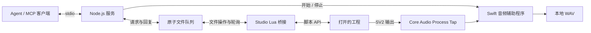

# Synthesizer V Studio Agent

[English](README.md) | 简体中文

## 项目简介

[Synthesizer V Studio 2 Pro（SV2）](https://dreamtonics.com/synthesizerv/) 是 Dreamtonics 开发的 AI 歌声合成编辑器，用户可通过音符和歌词创作歌声，并调整音高与演唱表现。其[脚本 API](https://resource.dreamtonics.com/scripting/) 向 JavaScript 和 Lua 脚本开放工程对象、选区和播放控制等能力。

本项目通过 Model Context Protocol（MCP），将这个脚本环境连接到本地 AI Agent。Node.js 服务与运行在 Studio 内的 Lua 脚本通过原子文件队列交换结构化请求，让 Agent 在用户继续使用 Studio 的同时，读取当前工程、编辑音符与参数曲线、管理轨道与音符组、调整速度拍号、唱法与混音器并控制播放。模型选择与 Agent 工作流程由 MCP 客户端负责。

当前实现提供 **31 个工具**，已在 **macOS、Studio 2.2.1 及其内嵌 Lua 5.4** 中验证。macOS 音频采集可将 SV2 播放输出录为 WAV。官方脚本 API 未提供工程保存、离线音频导出及声库选择接口；其他操作系统尚未验证。

## 安装示例

### 安装 Studio 桥接

需要支持脚本的 Synthesizer V Studio 2 Pro 和 Node.js 20.11 或更新版本，建议使用 Node.js 22 或更新版本。在项目目录中执行：

```sh
npm ci
npm run install-bridge
```

在 macOS 上，安装器会准备 `.sv-agent/`，将一个小型加载脚本安装到 Studio 的脚本目录，并输出包含实际本机路径的 MCP 配置。在 Studio 中打开工程，执行 **脚本 → 重新扫描**，再运行 **SV Agent Bridge**。

桥接会持续服务于该工程。再次运行脚本会延续当前逻辑会话。使用 `sv_stop_bridge` 停止；打开其他工程会停止当前桥接，需要重新启动。

若需指定脚本目录或使用不同的通信目录：

```sh
node scripts/install-bridge.mjs --scripts-dir /absolute/path/to/studio/scripts --dir /absolute/path/to/bus
```

macOS 以外的平台需要传入 `--scripts-dir`。两端必须使用同一通信目录，文件系统也需支持 Lua `os.rename` 原子替换文件。

### 接入 MCP 客户端

将安装器输出的配置添加到 MCP 客户端。也可以使用 [mcp-config.example.json](mcp-config.example.json)，将 `/absolute/path/to/sv_studio4agent` 替换为项目绝对路径。若客户端无法找到 `node`，将 `command` 改为 Node.js 可执行文件的绝对路径。添加服务后，重新加载客户端的 MCP 配置。

服务入口为 `src/cli.mjs`，使用 stdio 通信。默认通信目录是本项目中的 `.sv-agent/`。若使用前述自定义目录，配置服务运行：

```sh
node src/cli.mjs --dir /absolute/path/to/bus
```

安装器和服务也支持用 `SV_AGENT_DIR` 设置通信目录。这个服务本身不需要 API key。

可以通过随附客户端检查同一套 MCP 接口：

```sh
node scripts/agent-client.mjs list
node scripts/agent-client.mjs sv_status
node scripts/agent-client.mjs sv_get_project_summary
```

编辑前，`sv_status` 应返回 `online: true` 和预期工程路径。`BRIDGE_OFFLINE` 表示 Studio 脚本已停止或心跳过期。

### 启用 macOS 音频采集

音频采集需要 **macOS 14.2+** 和 Xcode Command Line Tools（或 Xcode）。在本机编译 Swift 辅助程序：

```sh
npm run build-audio
node scripts/agent-client.mjs sv_audio_status
```

首次录音可能触发系统音频录制授权，请按 macOS 提示授权给显示的应用，它可能是启动 MCP 的客户端。Process Tap 只选择 **Synthesizer V Studio 2 Pro** 进程，不录麦克风。沙箱可能隐藏 SV2 音频进程或阻止采集；若 SV2 正在运行但探测结果为零进程，需在允许访问 Core Audio 的本地环境中运行 MCP 服务。

停止播放，确认 `sessionId` 后，以唯一 ID 调用 `sv_capture_audio`：

```json
{
  "sessionId": "session-id-from-status",
  "requestId": "unique-take-id",
  "startSeconds": 15,
  "durationSeconds": 8,
  "tailSeconds": 0.3
}
```

工具等待采集就绪，再定位和播放；录音完成后停止播放、关闭 WAV，并恢复原先停止状态的播放位置。结果包含绝对路径及信号统计，文件和持久化结果存放于 `.sv-agent/recordings/`。同 ID、同参数重试返回原录音；中断后用 `sv_get_audio_result` 检查。MCP 客户端的工具超时应大于录音时长加 40 秒，随附命令行客户端允许 180 秒。

采集需要实际播放时长，会包含 SV2 内所有可听轨道、伴奏和效果。可先用 `sv_set_track_mixer` 独奏人声轨。录音存在启动前留白、IPC 调度延迟与尾音，**不是精确到采样的离线导出**。静音、丢帧、无效 PCM 或采集提前结束会返回错误。权限、计时与恢复细节见 [macOS 音频实现说明（英文）](docs/MACOS_AUDIO.md)。

## 开发指引与原理介绍

### 工作原理



Node 将每个请求发布为不可变 JSON 文件，再原子更新队列索引，并通过文件锁协调并发发布。Lua 使用 `SV:setTimeout` 轮询索引，校验请求后调用宿主 API，先记录完整结果，再发布回复。文件写入采用目标目录内的临时文件加 `rename`；Lua 桥接只使用文件 I/O，不启动 shell 或网络辅助进程。

会话将请求绑定到打开的工程。桥接每 50 ms 轮询，每秒发布心跳；心跳超过 6 秒未更新时，服务拒绝新操作。重复启动保留 `sessionId`、更换 `runtimeId`，让新回调循环接管运行。一个通信目录对应一个活动桥接。

### 接口与编辑流程

| 功能 | MCP 工具 |
| --- | --- |
| 状态与恢复 | `sv_status`、`sv_capabilities`、`sv_get_request_result`、`sv_stop_bridge` |
| 工程与选区读取 | `sv_get_project_summary`、`sv_read_project`、`sv_get_notes`、`sv_get_selected_notes` |
| 音符编辑 | `sv_update_notes`、`sv_add_notes`、`sv_delete_notes` |
| 参数曲线 | `sv_get_parameter_points`、`sv_set_parameter_points` |
| 工程结构 | `sv_get_project_structure` |
| 轨道与混音器 | `sv_create_track`、`sv_remove_track`、`sv_rename_track`、`sv_set_track_mixer` |
| 音符组与引用 | `sv_create_note_group`、`sv_rename_note_group`、`sv_remove_note_group`、`sv_attach_note_group`、`sv_detach_note_group`、`sv_set_group_reference` |
| 速度拍号与唱法 | `sv_set_time_axis`、`sv_set_voice_attributes` |
| 播放 | `sv_get_playback`、`sv_playback` |
| macOS 音频 | `sv_audio_status`、`sv_capture_audio`、`sv_get_audio_result` |

编辑前，先用 `sv_status` 确认工程并取得 `sessionId`，从工程摘要找到目标 `groupUuid`，再调用 `sv_get_notes` 获取当前 `revision`。例如，替换以下占位值后，将参数传给 `sv_update_notes`：

```json
{
  "sessionId": "session-id-from-status",
  "groupUuid": "target-group-uuid",
  "expectedRevision": "revision-from-notes",
  "requestId": "unique-edit-id",
  "updates": [{ "index": 1, "set": { "pitch": 67, "lyrics": "la" } }]
}
```

编辑、播放和停止工具都要求 `sessionId`。音符组编辑还要求 `expectedRevision`；发生冲突后需重新读取，编辑成功后可使用返回的新版本。结构化编辑会在创建撤销记录前校验完整批次，用户可在 Studio 中撤销。

结构、混音器、唱法与时间轴修改要求 `sv_get_project_structure` 返回的 `expectedProjectRevision`。它覆盖已暴露的结构、唱法、混音器、速度拍号以及各组的音符/曲线版本。轨道 UUID 与组引用索引进一步校验目标。删除库中的组之前须解除全部引用；不能解除主组引用，也不能删除最后一条轨道。删除轨道会移除其引用，但保留共享库组。

`sv_set_voice_attributes` 修改组引用的默认参数及具名 `vocalModeParams`，不选择歌手声库。模式名称应与已分配歌手支持的名称一致。宿主 `getVoice()` 可能省略默认属性，或返回空模式对象，并不列举歌手所有可用模式。部分参数以 Float32 保存，回读比较应允许微小精度误差。拍号修改使用**从零开始的小节编号**，速度标记使用 blick 位置。

音符和轨道索引从 **1** 开始。音符时间和参数位置使用 **blicks**，一个四分音符为 705,600,000 blicks；播放定位使用**秒**。音符时间相对于组，编辑共享组会影响它的所有引用。支持的曲线为 `pitchDelta`、`vibratoEnv`、`loudness`、`tension`、`breathiness`、`voicing`、`gender` 和 `toneShift`，取值范围以宿主返回的定义为准。

同一操作使用相同 `requestId` 和载荷重试，可取回已保存的结果。超时后，先用 `sv_get_request_result` 检查原 ID，再决定是否再次编辑。若执行中断且没有持久化完整结果，会返回 `INDETERMINATE`，不会自动重做。取消不能回滚已经开始的编辑。请求格式、限制和恢复行为详见[协议说明](docs/PROTOCOL.md)。

### 源码结构与测试

| 路径 | 职责 |
| --- | --- |
| `src/queue.mjs` | 原子发布、发布锁、会话与回复 |
| `src/server.mjs`、`src/tools.mjs`、`src/cli.mjs` | MCP 参数定义、工具分发与 stdio 入口 |
| `lua/SVAgentBridge.lua` | 轮询、生命周期与执行记录 |
| `lua/engine.lua`、`lua/extended.lua`、`lua/json.lua` | 宿主操作、结构校验与 JSON 编解码 |
| `src/audio.mjs`、`native/macos/` | 采集生命周期与 SV2 进程音频 Tap |
| `scripts/` | 安装器、MCP 客户端和实机联调脚本 |
| `tests/` | 队列、MCP 及模拟宿主的 Lua 测试 |

新增操作时，同步更新工具定义与 MCP 参数约束，实现宿主侧校验和分发，并验证失败及恢复行为。已安装的加载器每次启动都会读取工作区中的 Lua 模块：修改模块后停止并重启桥接；修改加载器后重新扫描 Studio；移动项目目录后重新安装。

```sh
npm test
# 如需指定 Lua 5.4 可执行文件：
LUA_BIN=/absolute/path/to/lua npm test
```

自动测试需要外置 Lua 5.4；正常运行使用 Studio 内嵌 Lua。自动测试不依赖 Studio 或本地工程素材。已通过队列、Lua、MCP 与采集生命周期自动测试。实机测试覆盖音符、工程结构、时间轴、唱法和混音器修改、人声独奏录音，以及升调后重新合成并采集的片段。测试后恢复已暴露的工程快照及播放位置；重复启动、停止与重启也已验证。

实机测试针对本地已验证样例：`test_proj/og.svp` 及其一次性副本 `test_proj/agent_queue_test.svp`，包含 3 条轨道和 1,197 个宿主可见音符。在 Studio 打开副本并启动桥接后执行：

```sh
node scripts/live-queue-test.mjs
# macOS：先编译音频辅助程序，再测试新增接口与重新合成
node scripts/live-extended-test.mjs
node scripts/live-render-test.mjs
```

工程素材、实机输出、队列文件、本机配置和历史探测脚本保留在本地，由 Git 忽略。实机证据写入 `test_results/atomic-queue/` 与 `test_results/macos/`；编译产物留在 Git 忽略的 `.build/`。请求与执行记录持续保留以支持恢复；归档通信目录前，先停止桥接和全部 MCP 进程。仓库范围见[提交边界](docs/COMMIT_SCOPE.md)。

## 参考项目鸣谢

感谢 [SynthVCopilot/SV1_Harmony_API](https://github.com/SynthVCopilot/SV1_Harmony_API) 提供基于文件的 Lua 桥接和 MCP 集成参考，帮助本项目探测与 Studio 通信的可行路线。

感谢 Dreamtonics 提供 Synthesizer V Studio 和[官方脚本手册](https://resource.dreamtonics.com/scripting/)，为本桥接使用的宿主 API 提供文档。
